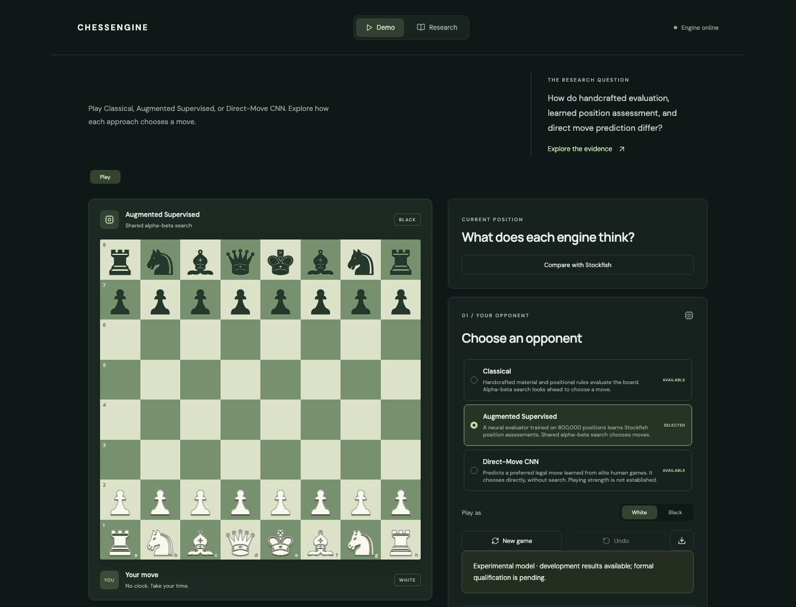

# ChessEngine Lab

A chess demo and experimental ML project exploring **position evaluation, move prediction, and learning through play**. It connects data preparation and training to a Python engine, NumPy inference, a FastAPI backend, and a React interface.

[Run locally](#run-the-demo-locally) · [Research and results](docs/research.md) · [How the engine works](docs/mathematics.md) · [Contributing](CONTRIBUTING.md)

## Three ways to choose a move

| Approach | How it plays | Evidence and limits |
| --- | --- | --- |
| Classical | Handcrafted evaluation with iterative-deepening alpha-beta search | An interpretable baseline. |
| Augmented Supervised — default | An MLP learns Stockfish position assessments; our alpha-beta engine chooses moves | Trained on 800,000 positions. Experimental; superior playing strength is not established. |
| Direct-Move CNN | A CNN learns elite human moves and selects a legal move directly, without search | Validation/export gate passed for the fixed seed-42 representative. Move agreement is not playing strength. |

The [release manifest](artifacts/models/manifest.json) pins both neural checkpoints and the default. Classical and Augmented Supervised share a ceiling of **30,000 nodes or 3 seconds**, whichever comes first. [Stockfish comparison](docs/position-comparison.md) is a separately identified reference; Stockfish never silently plays for our models. Gameplay does not train them.



## What I built

- A shared search engine with alpha-beta pruning, quiescence, bounded computation, and full-history draw handling; python-chess owns the rules.
- Game-separated data pipelines, pinned teacher labeling, reproducible training, and checked PyTorch-to-NumPy inference exports.
- Controlled experiments with frozen protocols, color-swapped openings, checkpoint identities, paired uncertainty, and preserved failures.
- A playable interface with legal move selection, promotion, undo, PGN export/replay, engine insight, and explicit offline, busy, and wake-up states.
- A research journal covering supervised learning, direct move prediction, root ordering, self-play, and evolutionary learning.

## What the experiments showed

The first bounded self-play study was **inconclusive**. A later, separate RL study scored **44.13% against its supervised initializer** (95% paired interval 41.54–46.58%), showing regression under that protocol. The policy/value follow-up completed a feasibility pilot; its full treatment comparison is deferred. These findings remain visible alongside successful training and failed release gates in the [research index](docs/research.md).

Lower validation error, teacher agreement, and deeper search are distinct measurements. This project does not claim an Elo rating or established superiority for its neural approaches.

## Run the demo locally

Use Python **3.10+** and Node.js **22**. Run all commands from the repository root:

```bash
python3 -m venv .venv
source .venv/bin/activate
python -m pip install -r requirements-runtime.txt
python -m pip install -e . --no-deps
python -m chessengine serve
```

In a second terminal:

```bash
npm --prefix web ci
npm --prefix web run dev
```

Open [the local demo](http://127.0.0.1:5173). The API runs on port 8000. The committed inference artifacts support the declared models; PyTorch and training data are unnecessary for play. Start from the repository root so the model and configuration paths resolve correctly.

The optional Stockfish reference needs a local executable; see [reference setup](docs/position-comparison.md). The demo reports its unavailability explicitly. A hosted demo URL has not been verified for this handoff.

## Explore the project

| Location | Contents |
| --- | --- |
| `src/chessengine/` | Rules integration, search, inference, data, training, evaluation, API, and reports |
| `web/` | React/TypeScript Demo and Research interface |
| `configs/` | Versioned experimental and serving settings |
| `tests/` | Chess correctness, numerical parity, research integrity, and release checks |
| `docs/` | Mathematics, protocols, results, and operations |

Start with the [research map](docs/research.md), [development and reproduction guide](docs/development.md), and [mathematical walkthrough](docs/mathematics.md). [Deployment](docs/deployment.md) and [historical handoffs](docs/archive/README.md) are separate operational references.

## License and publication

Project code is **GPL-3.0-or-later**; see [LICENSE](LICENSE) and [third-party notices](NOTICE). See [SECURITY.md](SECURITY.md) for reporting concerns and the [public-readiness audit](docs/public-readiness.md) for unresolved publication decisions, including tracked weights and Git-history metadata.
